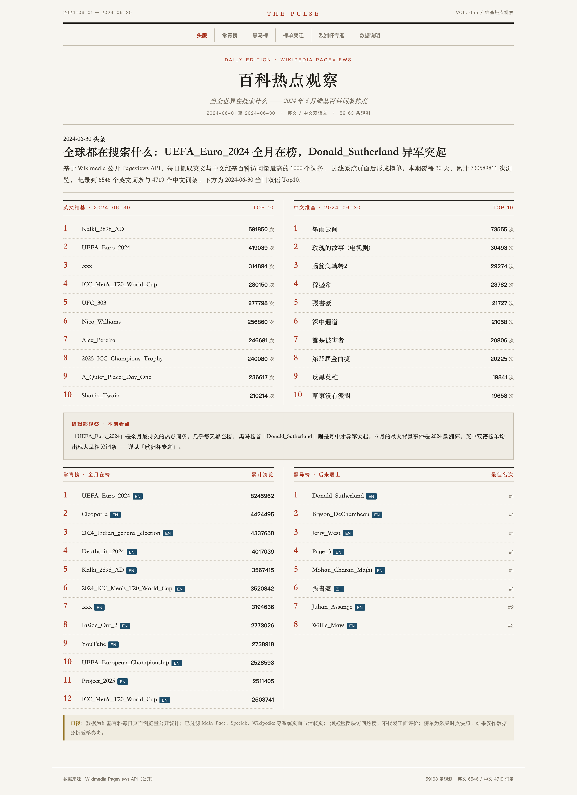
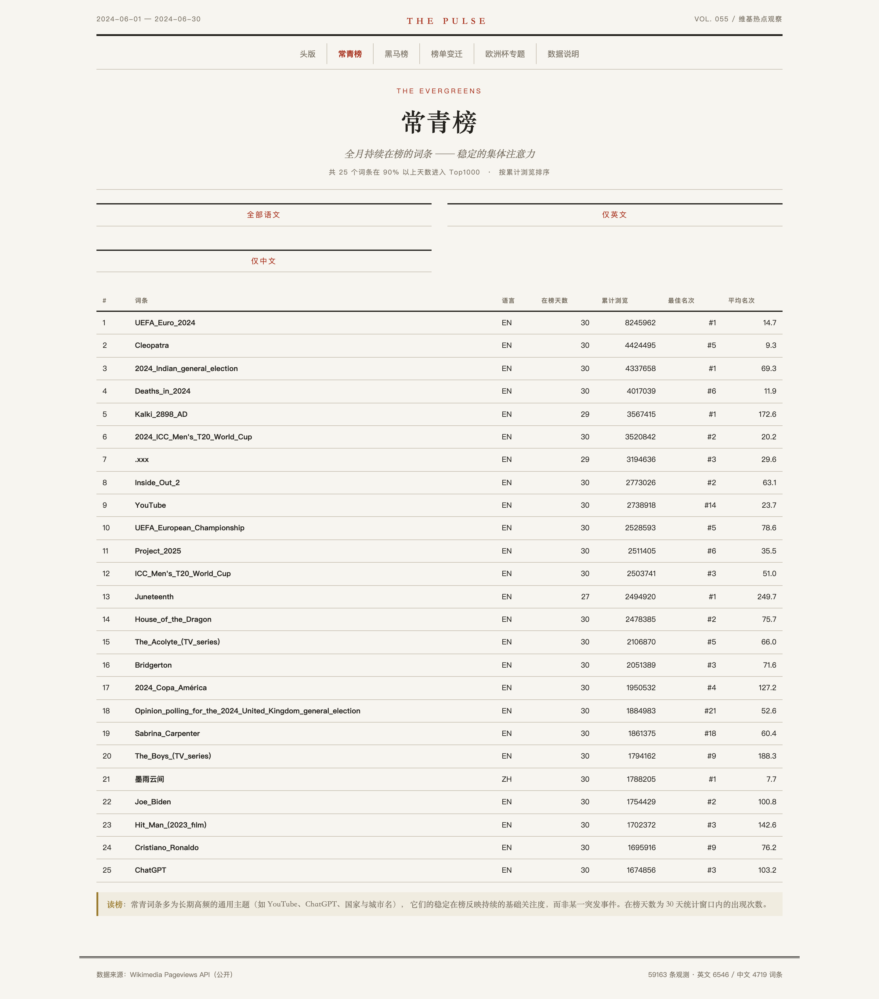
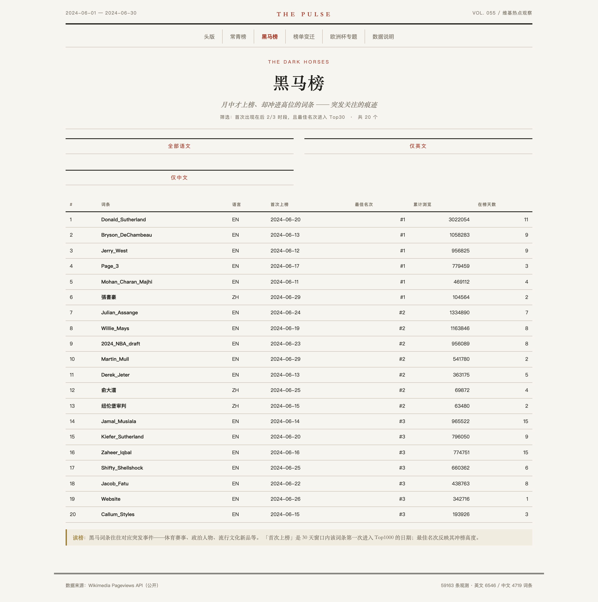
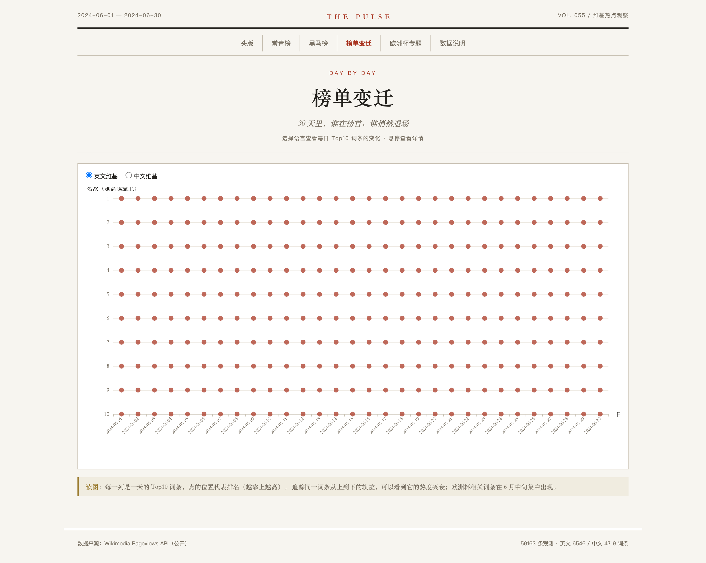
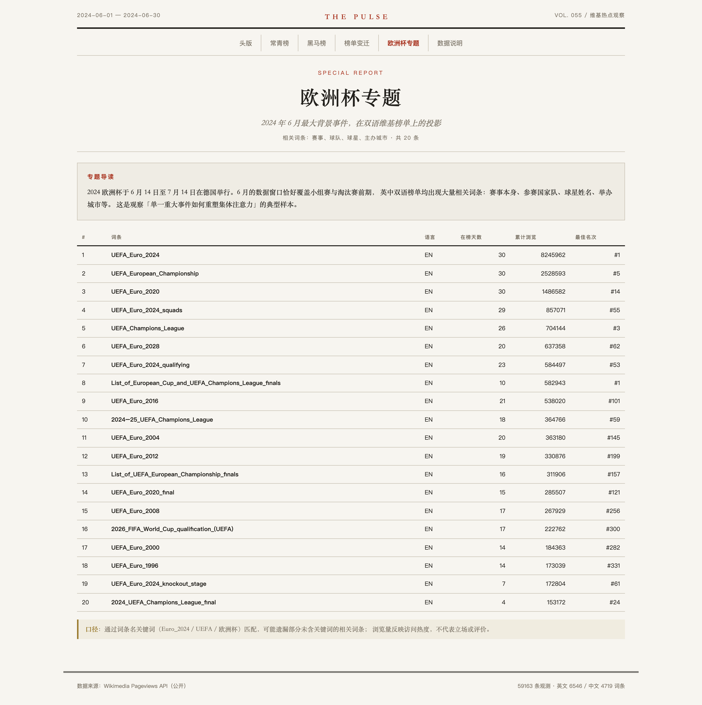
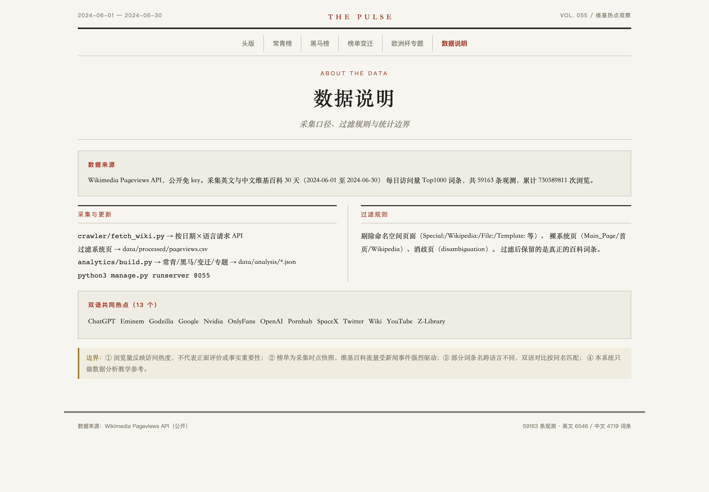

# 055 基于Wikipedia公开数据的百科热点追踪系统-设计展示

> **代码有偿获取 可接受定制 微信联系方式: csbysj2020 或 ACE2487，备注(BS)**

> **完整源码与全套文档 · 在线自助获取 >>> [https://mbd.pub/o/bread/YZaWmJlyZg==](https://mbd.pub/o/bread/YZaWmJlyZg==)**

> **成品页（功能介绍 / 更多选题）>>> [https://bishe.suilang.net/products/wiki-pulse](https://bishe.suilang.net/products/wiki-pulse)**

> 

> 

## 视频

> **点击查看 >>> [https://www.bilibili.com/video/BV1bRyszmE9T/](https://www.bilibili.com/video/BV1bRyszmE9T/)**

## 项目简介

报纸/杂志式榜单叙事（衬线头条、分栏、编号排行榜），刻意区别于通用数据看板。采集 Wikimedia Pageviews 公开数据（英文/中文维基百科每日 Top1000，2024-06）59163 条观测、30 天、英文 6546 / 中文 4719 个词条，累计约 730589811 次浏览。从持续上榜（常青榜）、黑马词条、每日 Top10 榜单变迁、双语共同热点与欧洲杯事件专题五个维度分析；常青榜首 UEFA_Euro_2024 全月在榜，黑马 Donald_Sutherland 首现后即登顶。6 个页面，Django + ECharts，本地化离线可用。浏览量反映访问热度，不代表正面评价，仅作教学参考。

维基百科的每日词条浏览量是观察集体注意力的独特数据窗口。

本项目设计并实现了一套基于 Wikimedia 公开数据的百科热点追踪系统：通过 Wikimedia Pageviews API 采集 2024 年 6 月英文与中文维基百科每日访问量 Top1000 词条，经系统页过滤后入库 59163 条观测，覆盖 30 天、英文 6546 / 中文 4719 个不同词条，累计浏览约 730589811 次。

系统从持续上榜（常青榜）、黑马词条、每日 Top10 榜单变迁、双语共同热点与欧洲杯事件专题五个维度组织分析；UEFA_Euro_2024 以 8245962 次浏览成为全月最持久热点，黑马 Donald_Sutherland 于 2024-06-20 首现后冲上榜首。

本仓库为**设计展示**：包含项目说明、技术架构、实验结果与运行截图；完整源码、任务书、开题报告、毕业论文与使用说明可通过上方链接自助获取，成品页可查看更多选题，也可联系微信咨询定制。

## 功能特性

1. 差异化视觉与页面：报纸/杂志式编排（衬线标题、分栏、编号排行榜），榜单叙事驱动，非通用总览大屏

2. 真实采集：Wikimedia Pageviews API（公开免 key）英中双语每日 Top1000，59163 条观测 / 30 天

3. 系统页过滤彻底：剔除命名空间页、裸系统页与消歧页，零泄漏，仅保留真实词条

4. 常青榜：674 个词条九成以上天数在榜，UEFA_Euro_2024 以 824 万浏览全月居首

5. 黑马榜：191 个词条首现晚却冲高，Donald_Sutherland 首现后即登顶，对应真实事件

6. 榜单变迁：ECharts 散点图呈现 30 天每日 Top10 排名，支持英中双语切换

7. 事件专题：欧洲杯专题展示单一重大事件如何重塑集体注意力

8. 双语对比：13 个英中同名共同热点，并如实说明同名匹配的局限

9. 合规边界：浏览量反映访问热度，不代表正面评价或事实重要性，仅作教学参考

## 技术架构

| 项目 | 说明 |
| --- | --- |
| 编程语言 | Python 3.8+ |
| Web 框架 | Django 4.2 |
| 图表 | ECharts（本地化离线可用） |
| 数据存储 | SQLite（PageView / CrawlLog 模型） |
| 样本规模 | 59163 观测 / 30 天 / 英 6546 + 中 4719 词条 |
| 运行端口 | http://127.0.0.1:8055 |
| 说明 | 数据直接读 analysis JSON，需先 migrate + import_wiki 入库 |

## 目录结构

以下为完整交付版的结构（本仓库仅作设计展示）：

```
wiki-pulse/
├── analytics/
│   ├── __init__.py
│   └── build.py
├── crawler/
│   ├── __init__.py
│   └── fetch_wiki.py
├── data/
│   ├── analysis/
│   │   ├── common.json
│   │   ├── darkhorse.json
│   │   ├── euro.json
│   │   ├── overview.json
│   │   ├── peaks.json
│   │   ├── persistent.json
│   │   └── timeline.json
│   ├── processed/
│   │   └── pageviews.csv
│   ├── raw/
│   │   ├── wiki_en_2024-06-01.json
│   │   ├── wiki_en_2024-06-02.json
│   │   ├── wiki_en_2024-06-03.json
│   │   ├── wiki_en_2024-06-04.json
│   │   ├── wiki_en_2024-06-05.json
│   │   ├── wiki_en_2024-06-06.json
│   │   ├── wiki_en_2024-06-07.json
│   │   ├── wiki_en_2024-06-08.json
│   │   ├── wiki_en_2024-06-09.json
│   │   ├── wiki_en_2024-06-10.json
│   │   ├── wiki_en_2024-06-11.json
│   │   ├── wiki_en_2024-06-12.json
│   │   ├── wiki_en_2024-06-13.json
│   │   ├── wiki_en_2024-06-14.json
│   │   ├── wiki_en_2024-06-15.json
│   │   ├── wiki_en_2024-06-16.json
│   │   ├── wiki_en_2024-06-17.json
│   │   ├── wiki_en_2024-06-18.json
│   │   ├── wiki_en_2024-06-19.json
│   │   ├── wiki_en_2024-06-20.json
│   │   ├── wiki_en_2024-06-21.json
│   │   ├── wiki_en_2024-06-22.json
│   │   ├── wiki_en_2024-06-23.json
│   │   ├── wiki_en_2024-06-24.json
│   │   └── …
│   └── …
└── …
```

## 数据与实验结论

- 系统采用 Django + ECharts，但在页面逻辑上以榜单叙事驱动而非统计看板驱动，视觉上采用报纸/杂志编排语言（衬线标题、分栏、编号排行榜），实现头版、常青榜、黑马榜、榜单变迁、欧洲杯专题、数据说明 6 个页面。
- 真实采集：Wikimedia Pageviews API（公开免 key）英中双语每日 Top1000，59163 条观测 / 30 天
- 常青榜：674 个词条九成以上天数在榜，UEFA_Euro_2024 以 824 万浏览全月居首
- 黑马榜：191 个词条首现晚却冲高，Donald_Sutherland 首现后即登顶，对应真实事件

## 交付内容

1. 完整源码（Django 应用 + 采集器 + 分析引擎 + 6 页面）
2. 真实数据（pageviews.csv + analysis JSON + SQLite 入库）
3. 任务书与开题报告（Word）
4. 毕业论文（Word 七章制）
5. 二次开发说明（Word+md）
6. 6 张截图 + 封面 + 演示视频

## 常见问题

**为什么视觉风格和其他成品差这么多？**

刻意设计：本成品用报纸/杂志编排（衬线头条、分栏、编号排行榜）替代通用数据看板，体现针对热点叙事主题的独立设计。

**浏览量高说明词条重要吗？**

不。浏览量只反映访问热度，受新闻事件强烈驱动，不代表正面评价或事实重要性，页面有明确口径说明。

**常青榜和黑马榜怎么区分？**

常青榜是九成以上天数在榜的稳定热点；黑马榜是首现较晚（后 2/3 时段）但最佳名次进入 Top30 的词条。

**双语共同热点怎么匹配？**

按词条名同名匹配，共 13 个；跨语言命名差异会遗漏，页面如实标注该局限。

**数据能更新吗？**

能。依次运行 crawler/fetch_wiki.py、analytics/build.py、manage.py import_wiki，刷新浏览器即可，数字走 stats.json 单一来源。

## 截图







